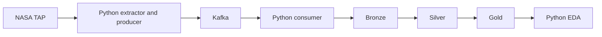

# NASA Exoplanet: Project Context and Technical Agreements

Last updated: 2026-11-02. Status: initial design and guided learning.

## Objective

Build a reproducible Python pipeline using the NASA Exoplanet Archive and perform multivariate exploratory data analysis of exoplanets. Explore clusters and similarity to Earth using explicit criteria; similarity does not imply habitability.

The student implements the project. Guidance explains concepts, proposes small exercises, and reviews code and results. Complete stages should not be implemented on the student's behalf without an explicit request.

## Agreed Scope

| Component | Decision |
| --- | --- |
| Python and uv | Extraction, transformation, validation, and analysis; dependencies declared in `pyproject.toml` and resolved in `uv.lock`. |
| NASA TAP | Initially query `pscomppars` using ADQL; review column definitions and provenance. |
| Medallion architecture | Original data in Bronze, cleaned data in Silver, and analytical data in Gold. These are logical responsibilities, not three mandatory services. |
| Docker Compose | A reproducible local environment for Kafka and any future services that need it. |
| Kafka | An exercise in event-driven data engineering and incremental integration. The catalog's volume does not require Kafka. |
| Git and GitHub | Version control, small changes, and pull request reviews. |
| GitHub Actions | Continuous integration (CI) only; no automated deployment. |
| Ruff and pytest | Formatting, static checks, and meaningful behavioral tests. |
| Parquet and DuckDB | Proposed storage and query tools; decision pending. |

AWS, Terraform, Kubernetes, CD, and model deployment are outside the initial scope. No cloud resources will be provisioned or cloud costs incurred as part of this initial scope.

## Target Architecture



NASA is a periodically queried source, not a native event stream. Query frequency must respect source limits and actual analytical needs.

Kafka retains messages according to its retention policy. Bronze retains snapshots for auditing and reprocessing. Consuming a message does not delete it. Writing to Bronze and committing an offset are not a single transaction: duplicate deliveries must be tolerated.

## Data Contracts and Layers

### Bronze

- Preserve received data without imputation, normalization, or field removal.
- Record the source, query, UTC extraction time, snapshot identifier, and contract version.
- Distinguish original HTTP response bytes from JSON that has been parsed and serialized again.
- Preserve historical snapshots; never silently overwrite earlier extractions.

### Silver

- Apply explicit types, units, and validation rules.
- Preserve available uncertainties, measurement limits, and provenance. Distinguish measured values from estimates.
- Handle duplicates using a documented key and policy. Missing values are not zeros.
- Quarantine rejected records with a traceable rejection reason.

### Gold

- Define one row per planet and a reference date for the analysis.
- Document feature selection, transformations, exclusions, and any imputation.
- Add Earth as an identifiable external reference with documented sources.
- Avoid automatic inclusion of physically redundant variables, such as mass, radius, and density, without assessing their dependence.
- Examine detection bias, missingness, and ranking sensitivity to scaling and feature selection.

## Code Quality and Structure

Prioritize understandable code before introducing abstractions. Use English identifiers. This context document is maintained in English; explanatory guidance can remain in Spanish. Each function should have one responsibility, clear inputs and outputs, and useful type annotations.

Separate HTTP access, Kafka publishing, storage, and transformation. Keep reusable logic outside notebooks and entry points. Use `main()` and the `if __name__ == "__main__":` guard to avoid executing work when modules are imported.

Use timeouts, HTTP status checks, and response structure validation. Retries must be bounded and respect rate limits. Do not catch broad exceptions merely to hide failures. Execution failures should be logged and produce a nonzero exit status when appropriate.

Keep paths, addresses, and parameters separate from business logic. Never store credentials in source code, logs, or Git. Use logging for operational visibility and timezone-aware UTC timestamps.

Proposed structure for gradual evolution; do not create empty modules in advance:

```text
Nasa_exoplanet/
  pyproject.toml
  uv.lock
  compose.yaml
  src/nasa_exoplanet/
    extraction/
    messaging/
    storage/
    transformation/
  tests/
    fixtures/
  notebooks/
  docs/
  data/
    bronze/
    silver/
    gold/
  .github/workflows/
```

Version source code, configuration, documentation, and small test fixtures. Exclude `.venv`, caches, secrets, and large datasets. Raw external data does not automatically belong in test fixtures.

## Continuous Integration: CI Only

Planned workflow for pull requests and integrated changes:

1. Check out the code and configure explicit Python and uv versions.
2. Install dependencies using `uv sync --locked`.
3. Run `uv run ruff check .` and `uv run ruff format --check .`.
4. Run `uv run pytest` once meaningful tests exist.
5. Later add Kafka integration tests, kept separate from unit tests.

Routine tests will use controlled fixtures without querying NASA. Live connectivity checks will be distinguished from the deterministic test suite. Building an image in CI is a possible extension, not an implemented capability.

CI verifies software; it does not necessarily run production ingestion or guarantee the quality of future data. Images will not be published, Terraform applied, or infrastructure deployed automatically.

## Reported Progress and Pending Work

Based on the student's shared execution results, sample extraction works, and Kafka has successfully produced and consumed console messages. The repository was inspected and contains `pyproject.toml`, `uv.lock`, and `compose.yaml`; requests, Ruff, and pytest are declared dependencies.

The current Compose configuration has one broker and exposes its port on localhost only. It declares neither a persistent volume nor high availability. A Python client connection from the host has not yet been verified.

Pending work includes the Python producer, message contract and event identification, Bronze consumer, Kafka persistence, data quality rules, transformations, EDA, and CI workflow. Document and test each decision before expanding the architecture.

## Learning Approach

Small objective -> student implementation -> execution -> reasoned review -> improvement -> commit.

Define acceptance criteria for each stage. Avoid large changes and tools without a concrete responsibility. This document records agreements and proposals; it is not a substitute for execution evidence.

## References

- [NASA TAP](https://exoplanetarchive.ipac.caltech.edu/docs/TAP/usingTAP.html)
- [Catalog Data Dictionary](https://exoplanetarchive.ipac.caltech.edu/docs/API_PS_columns.html)
- [uv Project Guide](https://docs.astral.sh/uv/guides/projects/)
- [Apache Kafka Quickstart](https://kafka.apache.org/quickstart/)
- [GitHub Actions](https://docs.github.com/en/actions)
